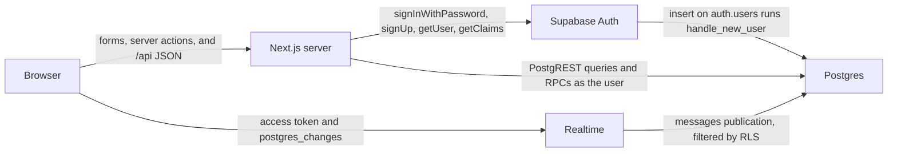
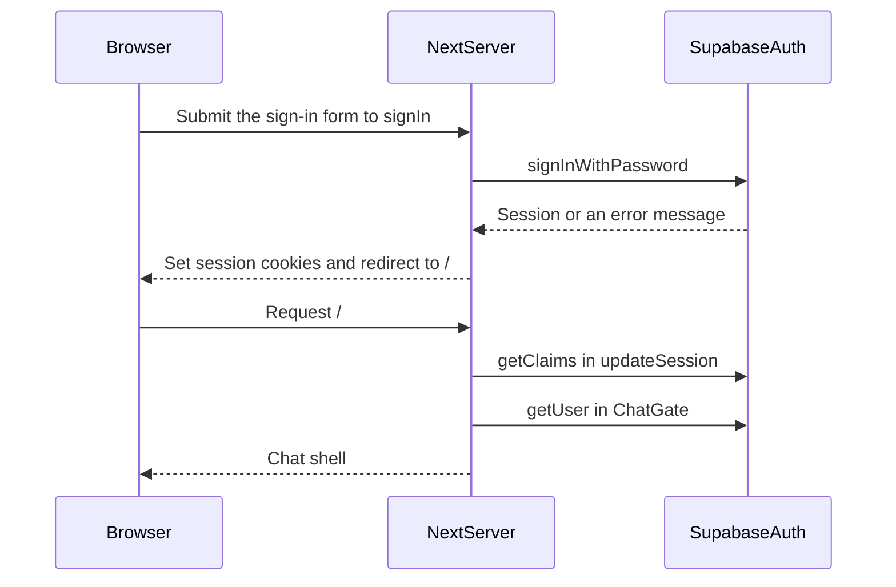
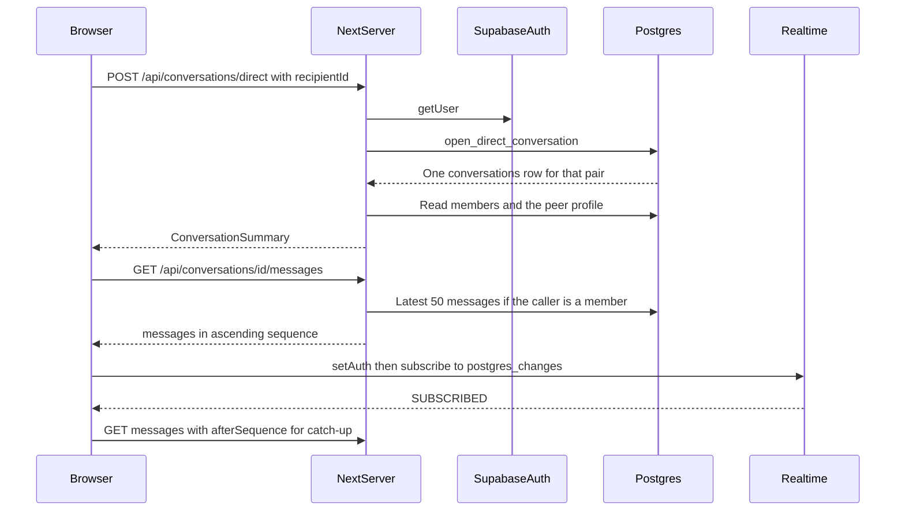
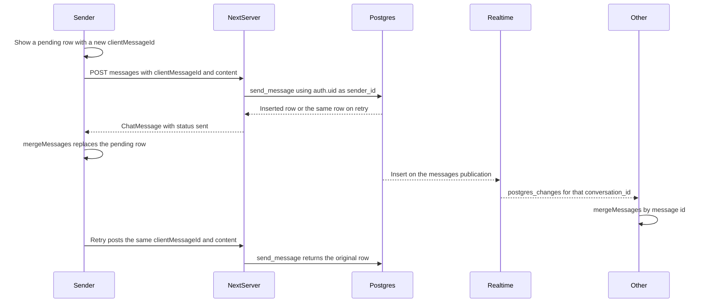
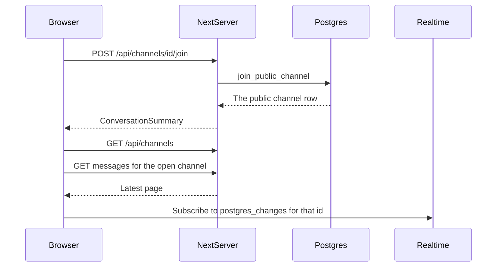
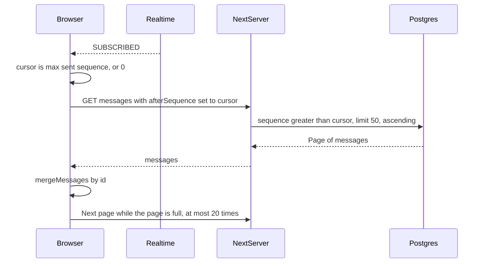

# Architecture

This is a direct-message and public-channel chat. Two signed-in people share one conversation. A signed-in person can also create a public channel, join one, and leave it. History is stored in Postgres and stays ordered by a per-conversation sequence number. Other members see a new message without refreshing.

The stack is Next.js 16 App Router, Supabase Auth, Postgres with row level security, and Supabase Realtime `postgres_changes`. There is no Express server and no Socket.IO.

Chat data does not go to the database from the browser. The browser calls Next.js route handlers under `app/api`. Those handlers use the signed-in user's cookie session. Sign-in is also a Next.js server action: the browser posts the email and password to the Next.js server, and the server calls Supabase Auth. After that, the browser Supabase client is used for Realtime only (plus a display-name lookup). It does not send messages.

The database password and the Postgres connection string are not read by the app. They are only for applying SQL (the Supabase SQL Editor, or a local `psql` session). Do not commit them, and do not expose them to the browser.

## System diagram

## Authentication

### Cookie session

`@supabase/ssr` stores the Supabase session in cookies.

- [`lib/supabase/server.ts`](../lib/supabase/server.ts) `createClient` builds a server client from `cookies()` in `next/headers`. Route handlers, server actions, and the chat page use this client. A new client is created per call. It is not stored in a global.
- [`lib/supabase/client.ts`](../lib/supabase/client.ts) `createClient` builds a browser client. [`components/chat/chat-shell.tsx`](../components/chat/chat-shell.tsx) uses it to call `supabase.auth.getSession`, pass `access_token` to `supabase.realtime.setAuth`, subscribe to `postgres_changes`, and read `profiles.display_name` for a live message.
- [`lib/supabase/proxy.ts`](../lib/supabase/proxy.ts) `updateSession` builds a third client from the request cookies. [`proxy.ts`](../proxy.ts) calls `updateSession` on every matched request (static files and images are excluded).

`updateSession` calls `supabase.auth.getClaims()` immediately after creating the client. That call refreshes the session cookies. The response that leaves the proxy must carry those `Set-Cookie` headers, including when the proxy redirects. If `NEXT_PUBLIC_SUPABASE_URL` or `NEXT_PUBLIC_SUPABASE_PUBLISHABLE_KEY` is missing, `hasEnvVars` in [`lib/utils.ts`](../lib/utils.ts) is false and the proxy skips the check.

Redirects in `updateSession`:

- No session, and the path is not `/api` and not an auth page: redirect to `/login`. Auth pages are `/login`, `/signup`, and anything under `/auth`.
- A session on `/login` or `/signup`: redirect to `/`.
- `/api` is never redirected. A missing session becomes a 401 from the route handler.

The chat page has a second check. [`components/chat/chat-gate.tsx`](../components/chat/chat-gate.tsx) `ChatGate` calls `supabase.auth.getUser()`. If there is no user, it redirects to `/login`. If there is a user, it loads `profiles` and renders the shell.

### Sign up, sign in, sign out

[`app/login/page.tsx`](../app/login/page.tsx) and [`app/signup/page.tsx`](../app/signup/page.tsx) render [`components/auth/credentials-form.tsx`](../components/auth/credentials-form.tsx). The form calls the server actions in [`lib/auth/actions.ts`](../lib/auth/actions.ts).

`signIn` requires an email and a password, then calls `supabase.auth.signInWithPassword`. A Supabase error is returned as `{ error: message }` and shown on the form. Success calls `redirect("/")`.

`signUp` requires an email, a password of at least 6 characters, and a matching confirmation. It calls `supabase.auth.signUp` with `emailRedirectTo` set to `https://$VERCEL_URL/` when `VERCEL_URL` is set, otherwise `http://localhost:3000/`. If Supabase returns an error, the form shows `error.message`. If Supabase returns a user but no session, the action does not redirect. It returns this error: "Account created, but email confirmation is still required. Turn off Confirm email in the Supabase Auth provider settings, then sign in." That happens when the Email provider has **Confirm email** turned on, because Supabase will not create a session until the address is confirmed. [`docs/setup.md`](setup.md) tells you to turn **Confirm email** off for local testing. The starter route [`app/auth/confirm/route.ts`](../app/auth/confirm/route.ts) can verify an email OTP (`token_hash` and `type`), but `signUp` does not send people there.

`signOut` calls `supabase.auth.signOut()` and redirects to `/login`. The sidebar form in [`components/chat/sidebar.tsx`](../components/chat/sidebar.tsx) uses that action.

A new row in `auth.users` runs `handle_new_user` in [`supabase/migrations/0001_chat.sql`](../supabase/migrations/0001_chat.sql). The trigger inserts `profiles` with `display_name` set to the email local-part, or `user` when that part is empty.

`/auth/login` and `/auth/sign-up` only redirect to `/login` and `/signup`. The starter `LoginForm` in `components/login-form.tsx` does call `signInWithPassword` from the browser, and it is not what `/login` uses.

### Environment variable names

The app reads these names. Values stay in `.env.local` or the host's environment. Do not commit them.

| Name | Who reads it |
| --- | --- |
| `NEXT_PUBLIC_SUPABASE_URL` | Browser client, server client, and proxy. This is the project URL. |
| `NEXT_PUBLIC_SUPABASE_PUBLISHABLE_KEY` | Same three clients. This is the publishable key (or the legacy anon key). It is public by design. It is not the service-role key. |
| `VERCEL_URL` | [`lib/auth/actions.ts`](../lib/auth/actions.ts) for the sign-up redirect origin, and [`app/layout.tsx`](../app/layout.tsx) for `metadataBase`. Absent locally, so the origin is `http://localhost:3000`. |

The app does not use a service-role key and does not use `DATABASE_URL` or the database password. The connection string is only for applying the SQL in `supabase/migrations`. It must not be committed and must not be sent to the browser.

## How a route handler gets the user id

Every handler is wrapped by `withApi` in [`lib/api/http.ts`](../lib/api/http.ts). `withApi` creates a `requestId` (`crypto.randomUUID()`), sets the `x-request-id` response header, and turns unexpected exceptions into HTTP 500 with code `50000` and message `request failed`. Next.js control-flow errors (redirects) are rethrown.

The handler then calls `requireSession` in [`lib/api/session.ts`](../lib/api/session.ts):

1. `createClient()` from [`lib/supabase/server.ts`](../lib/supabase/server.ts) reads the cookie session.
2. `supabase.auth.getUser()` validates that session with Supabase Auth.
3. On failure the handler returns 401, code `28000`, message `not authenticated`.
4. On success the session is `{ supabase, userId, email }`. `userId` is `data.user.id` from Auth. `email` is `data.user.email`.

That same `supabase` client is what talks to Postgres. PostgREST sees the user's access token, so `auth.uid()` inside SQL is that user. The client never sends a sender id. `POST /api/conversations/:id/messages` accepts only `clientMessageId` and `content`. `send_message` sets `sender_id` to `auth.uid()`.

Postgres errors are mapped by `postgresError`:

| SQL code | HTTP | Body |
| --- | --- | --- |
| `22023` | 400 | code, Postgres message, requestId |
| `22P02` | 400 | same |
| `23514` | 400 | same |
| `23505` | 409 | same |
| `28000` | 401 | same |
| `42501` | 403 | same |
| `P0002` | 404 | same |
| code starting with `PGRST` | 500 | the PostgREST code and message |
| anything else | 500 | code `50000`, message `request failed` |

Application errors from `apiError` use the same JSON shape: `{ code, message, requestId }`.

## API endpoints

All of these require a session. The success JSON below is the body. Errors use the shape above.

`ConversationSummary` is `{ id, type, name, createdAt, peer }`. `peer` is `{ userId, displayName }` or `null`. `loadConversationSummaries` in [`lib/api/conversations.ts`](../lib/api/conversations.ts) sets `peer` to one other member when the membership query returns one. Channel titles do not use `peer`.

`ChatMessage` is `{ id, conversationId, senderId, senderDisplayName, clientMessageId, sequence, content, createdAt, status }`. Route handlers always set `status` to `"sent"`. `sequence` is a number. `senderDisplayName` is the profile name, or `null`.

### `GET /api/me`

Auth required. No body.

Success: `{ userId, displayName, email }` from `profiles` plus the session email.

Errors: 401 `28000` not authenticated. 404 `P0002` profile not found. Other read failures follow `postgresError`.

### `PATCH /api/me`

Auth required. Body: `{ displayName: string }`. The handler trims it. The trimmed value must be 1 to 40 characters and must not contain characters U+0000 through U+001F.

Success: the same object as `GET /api/me`.

Errors: 400 `22023` if the body is not an object, `displayName` is missing, or the trimmed name is invalid (`displayName is required` or `display name must be 1 to 40 characters`). 401 `28000`. 404 `P0002` profile not found. The update is a normal `profiles` update of `display_name` for `user_id = session.userId`, allowed by the `profiles_update_own` policy and the column grant.

### `GET /api/users`

Auth required. Query string: optional `query`. No body.

The handler lists up to 20 `profiles` rows whose `user_id` is not the caller, ordered by `display_name` ascending. A non-empty `query` adds a case-insensitive `display_name` match. `%`, `_`, and `\` in the query are escaped. `query` longer than 80 characters is rejected.

Success: `{ users: [{ userId, displayName }] }`.

Errors: 400 `22023` `query is too long`. 401 `28000`.

### `GET /api/conversations`

Auth required. No body.

The handler reads `conversation_members` for the caller, then loads those conversations. Row level security already limits both reads to conversations the caller belongs to. Results are ordered by `conversations.created_at` descending. This list includes direct messages and channels.

Success: `{ conversations: ConversationSummary[] }`.

Errors: 401 `28000`, plus `postgresError` on a failed read.

### `POST /api/conversations/direct`

Auth required. Body: `{ recipientId: string }`. `recipientId` must be a UUID.

The handler calls `open_direct_conversation` with `{ recipient_id }`, then returns the summary for that id.

Success: one `ConversationSummary`.

Errors:

- 400 `22023` `recipientId is required` when the body is not a JSON object.
- 400 `22023` `recipient_id is required` when `recipientId` is missing or null.
- 400 `22023` `recipientId must be a uuid`.
- 400 `22023` `cannot open a direct conversation with yourself` from the function.
- 404 `P0002` `recipient not found`.
- 401 `28000`.
- 500 `50000` if the function returns no row or the summary cannot be reloaded.

### `GET /api/conversations/:id/messages`

Auth required. `:id` must be a UUID. Optional query: `beforeSequence`, `afterSequence`. Each value, when present, must be a string of digits that fits a safe integer. No body.

The handler loads `conversation_members` for this id and this user. No row means 403, even before the message query. It then selects `id, conversation_id, sender_id, client_message_id, sequence, content, created_at` from `messages`.

- `beforeSequence` adds `sequence < beforeSequence`.
- `afterSequence` adds `sequence > afterSequence`.
- If `afterSequence` is absent, the query is descending and the handler reverses the page, so the JSON array is ascending. That is the latest page.
- If `afterSequence` is present, the query stays ascending.
- The limit is `MESSAGE_PAGE_SIZE` (50) from [`lib/chat/messages.ts`](../lib/chat/messages.ts).

The UI never sends both cursors. The handler applies both filters if a client does.

Success: `{ messages: ChatMessage[] }`, ascending by sequence within the page.

Errors: 400 `22023` `conversation id must be a uuid`. 400 `22023` `sequence must be an integer`. 403 `42501` `not a member of this conversation`. 401 `28000`.

### `POST /api/conversations/:id/messages`

Auth required. `:id` must be a UUID. Body: `{ clientMessageId: string, content: string }`. `clientMessageId` must be a UUID. `content` must be a string whose length is 1 to 4000. The handler does not trim `content`.

The handler calls `send_message` with `conversation_id` from the URL, `client_message_id`, and `content`. It does not pass a sender id.

Success: one `ChatMessage`, not wrapped in an object.

Errors:

- 400 `22023` `clientMessageId and content are required` when the body is not a JSON object.
- 400 `22023` `clientMessageId must be a uuid`.
- 400 `23514` `content length must be between 1 and 4000 characters` from the handler, or the same text from the function.
- 403 `42501` `not a member of this conversation`.
- 404 `P0002` `conversation not found`.
- 409 `23505` `client_message_id already used with different conversation or content`.
- 401 `28000`.
- 500 `50000` if the function returns no row.

### `GET /api/channels`

Auth required. No body. Calls `list_public_channels`.

Success: `{ channels: [{ id, name, visibility, joined }] }`. Rows that are missing a string `id` or `name` are dropped. `joined` is true only when the function value is boolean `true` or the string `"true"`.

Errors: 401 `28000`, plus `postgresError` (the function raises `28000` if `auth.uid()` is null, which the session check already covers).

### `POST /api/channels`

Auth required. Body: `{ name: string }`. The name is trimmed. [`lib/chat/channel-name.ts`](../lib/chat/channel-name.ts) `invalidChannelName` rejects an empty name, a name longer than 80 characters, and names that contain control characters.

Success: one `ConversationSummary` for the channel the caller just created and joined.

Errors: 400 `22023` `name is required`. 400 `22023` `channel name must be 1 to 80 characters`. 409 `23505` `a channel with this name already exists`. 401 `28000`. 500 `50000` if the summary cannot be loaded.

### `POST /api/channels/:id/join`

Auth required. `:id` must be a UUID. No body. Calls `join_public_channel`.

Success: one `ConversationSummary`. Joining again is a success; the function does not insert a second membership.

Errors: 400 `22023` `channel id must be a uuid`. 404 `P0002` `channel not found` when the id is not a public channel with a null `dm_key`. 401 `28000`. 500 `50000` if the summary cannot be loaded.

### `DELETE /api/channels/:id/members/me`

Auth required. `:id` must be a UUID. No body. Calls `leave_channel`. This removes the caller only.

Success: `{ id }` using the path id.

Errors: 400 `22023` `channel id must be a uuid`. 404 `P0002` `channel not found` when the conversation does not exist, and also when the caller is not a member of a direct message (so a non-member cannot learn that a DM exists). 403 `42501` `cannot leave a direct message` when the caller is a member of that DM. 401 `28000`.

## Database

The schema is [`supabase/migrations/0001_chat.sql`](../supabase/migrations/0001_chat.sql) plus [`supabase/migrations/0002_channels.sql`](../supabase/migrations/0002_channels.sql). Apply `0001` once, then `0002`. The running app does not migrate itself.

### Tables

`profiles`

- `user_id` uuid primary key, references `auth.users`, cascades on delete
- `display_name` text, not null
- `created_at` timestamptz

`conversations`

- `id` uuid primary key
- `type` text, `'dm'` or `'channel'`, default `'dm'`
- `dm_key` text, nullable
- `name` text, nullable
- `visibility` text, not null, default `'private'`
- `created_by` uuid, references `auth.users`
- `next_sequence` bigint, not null, default 0
- `created_at` timestamptz
- Unique `dm_key` with `UNIQUE NULLS DISTINCT`, so many channels can store a null `dm_key` and two DMs cannot share a key
- Check: a DM has a non-null `dm_key`, and a channel has a null `dm_key`

`conversation_members`

- Primary key `(conversation_id, user_id)`
- `role` text, default `'member'` (the functions do not branch on role)
- `joined_at` timestamptz

`messages`

- `id` uuid primary key
- `conversation_id`, `sender_id`
- `client_message_id` uuid, not null
- `sequence` bigint, not null
- `content` text, length 1 to 4000
- `created_at` timestamptz
- Unique `(sender_id, client_message_id)`
- Unique `(conversation_id, sequence)`, which is also the history index

`0002` adds a unique index on `lower(name)` for rows where `type = 'channel'` and `name` is not null.

`messages` is added to the `supabase_realtime` publication. That is the live-delivery source.

### Row level security

RLS is enabled on all four tables. `anon` and `authenticated` lose table-level write grants. `authenticated` can `SELECT` all four, and can `UPDATE` only `profiles.display_name`.

Policies:

- `profiles_select_authenticated`: any signed-in user can read every profile. That is how people search and how sender names resolve.
- `profiles_update_own`: a user can update only their own profile row.
- `conversations_select_member`, `conversation_members_select_member`, and `messages_select_member`: the row is visible only when `private.is_conversation_member(conversation_id)` is true.

`private.is_conversation_member` is `security definer` so the policy can read membership without recursing through RLS. The `private` schema is not exposed by PostgREST.

There are no insert, update, or delete policies for conversations, members, or messages. Clients cannot write those tables directly. Inserts and the membership delete go through `security definer` functions. Those functions run as the table owner and bypass RLS. The migrations say not to enable `FORCE ROW LEVEL SECURITY` on these tables, or the functions would stop being able to write. Each function still checks `auth.uid()` itself.

### `dm_key`, idempotency, and sequence

`open_direct_conversation` builds `dm_key` by ordering the two user ids as text and joining them with `:`. The smaller text is first. The insert is `ON CONFLICT (dm_key) DO NOTHING`. A concurrent open of the same pair returns the existing row. Both users are inserted into `conversation_members` with `ON CONFLICT DO NOTHING`. The caller cannot open a DM with themselves. The recipient must exist in `auth.users`.

`send_message` refuses non-members. If this sender already used this `client_message_id` with the same conversation and the same content, it returns that row and does not insert again. If the id was used with different content or a different conversation, it raises `23505`. Otherwise it increments `conversations.next_sequence` and inserts the message with that new value as `sequence`. The sender is always `auth.uid()`. The unique `(conversation_id, sequence)` constraint is what keeps order stable. A retry of the same client message id is safe because of the unique `(sender_id, client_message_id)` pair and the early return.

### RPCs

| Function | What it does |
| --- | --- |
| `open_direct_conversation(recipient_id uuid)` | Returns the `conversations` row for the unique private DM between `auth.uid()` and `recipient_id`, creating it and both memberships if needed. |
| `send_message(conversation_id, client_message_id, content)` | Returns the existing matching message or inserts one. `sender_id` is `auth.uid()`. `sequence` is the incremented `next_sequence`. |
| `create_channel(channel_name text)` | Inserts a `channel` with `dm_key` null, `visibility` `'public'`, and the trimmed name. Adds the caller as a member. Duplicate names raise `23505`. |
| `join_public_channel(conversation_id uuid)` | Adds the caller to a public channel. Already a member is a no-op. Anything that is not a public channel with a null `dm_key` raises `P0002`. |
| `leave_channel(conversation_id uuid)` | Deletes the caller's membership. A member cannot leave a DM (`42501`). A non-member of a DM gets `P0002`. Leaving works for the person who created the channel. |
| `list_public_channels()` | Returns `id`, `name`, `visibility`, and `joined` for public channels only, ordered by lower name then id. Direct messages are not included. `joined` is true when the caller is already a member. This function is how non-members discover channels, because the select policy hides conversations they have not joined. |

## Reading messages

Page size is 50 (`MESSAGE_PAGE_SIZE`).

On open, [`components/chat/chat-shell.tsx`](../components/chat/chat-shell.tsx) watches `activeId`. `start` calls `GET /api/conversations/:id/messages` with no cursor. That returns the latest page, oldest of that page first. `replaceWithLatest` keeps any local pending or failed rows whose `clientMessageId` is not in the server page, and drops pending rows that the server already has. If the page has fewer than 50 messages, that conversation is marked exhausted and the earlier-history control stays hidden.

The thread does not fetch when the user scrolls up. In [`components/chat/thread.tsx`](../components/chat/thread.tsx), `onScroll` only records whether the reader is within 80 pixels of the bottom (`stickRef`). New messages and a send jump to the bottom when that flag is set. Earlier history is a button, "Load earlier messages". `loadEarlier` in the shell finds the oldest message with `status === "sent"` and calls `GET /api/conversations/:id/messages?beforeSequence=` plus that sequence. `mergeMessages` inserts the older rows. The thread saves `scrollHeight - scrollTop` before the request and restores it after the new rows render, so the viewport does not jump. A short page marks the conversation exhausted.

`sortMessages` orders sent messages by `sequence`, then `createdAt`. Pending and failed rows sort after sent rows.

## Delivering messages

Sending is an HTTP write. Live delivery is a Postgres insert that Realtime forwards. The client merges by message id, and falls back to `clientMessageId` plus `senderId` so the optimistic row becomes the saved row.

`sendMessage` in the shell:

1. Generates `clientMessageId` with `crypto.randomUUID()` unless the caller passed one (retry).
2. Inserts a local row with `id` `local:<clientMessageId>`, `sequence` 0, and `status` `"pending"`. A retry of an existing id only flips that row back to `"pending"`.
3. `POST /api/conversations/:id/messages` with `{ clientMessageId, content }`.
4. On success, `mergeMessages` replaces the pending row because `clientMessageId` and `senderId` match, and copies the real `id` and `sequence`.
5. On failure, that same `clientMessageId` is marked `"failed"`. The Retry button calls `sendMessage(content, clientMessageId)` again. `send_message` returns the original row if the first request actually committed.

The shell subscribes after the first page load:

- Channel name `messages:<conversationId>`.
- Event `postgres_changes`, event `*`, schema `public`, table `messages`, filter `conversation_id=eq.<conversationId>`.
- Before `subscribe`, it sets the Realtime auth token from `getSession()` when an access token exists.
- `messageFromRealtime` accepts `payload.new` only when it has the message columns. The row is merged into state. The sender's own live echo merges into the optimistic row by `clientMessageId`.
- Another member's browser receives the event because `messages` is in `supabase_realtime` and the select policy allows members to read that conversation. The subscriber is using that member's access token.
- Status `SUBSCRIBED` sets the connection to live and runs catch-up. `CHANNEL_ERROR`, `TIMED_OUT`, and `CLOSED` set it to reconnecting. Leaving the conversation calls `removeChannel`.

Catch-up (`catchUp`) starts at `maxSentSequence` for messages already in memory (0 when none are sent). It requests `afterSequence` until a page is empty or shorter than 50, and it stops after 20 pages. Those rows go through `mergeMessages`. A catch-up failure sets the connection to reconnecting.

`apiFetch` in [`components/chat/api.ts`](../components/chat/api.ts) sends cookies with `fetch` (same origin). A 401 response assigns `window.location` to `/login`.

### Sign in

Sign-up is the same path through `signUp`, except a missing session returns the Confirm email error and does not redirect.

### Open or create a DM

`SupabaseAuth` in that diagram is the Auth check inside `requireSession`. The DM key is computed in Postgres, not in the client.

### Send a message

If the POST fails before a row exists, the local status becomes `failed` and no Realtime event is sent. The next retry uses the same `clientMessageId`.

### Join a channel

Create channel is the same after the response: `POST /api/channels` calls `create_channel`, the shell selects that conversation, and the open-conversation effect loads messages and subscribes. Leave is `DELETE /api/channels/:id/members/me`, then the shell drops that conversation from local state. It does not delete messages.

### Reconnect catch-up

A dropped channel status sets the UI to reconnecting. The next `SUBSCRIBED` callback runs this catch-up again. Realtime can also deliver events while the page is open; catch-up covers the gap around the subscribe.

## Channel and DM authorization

A direct message is private. Only `open_direct_conversation` creates one. Both users are members. `list_public_channels` never returns it. A non-member fails the select policies, the message route's membership check (403), and `send_message` (403). `leave_channel` will not remove a DM membership.

A channel created by `create_channel` is public and has a null `dm_key`. The creator is a member immediately. Anyone signed in can see it through `list_public_channels` without being a member. They cannot read its messages or its conversation row until `join_public_channel` inserts their membership. After that, the same member checks as a DM apply to read and send. `leave_channel` deletes only the caller's membership. The channel row and its messages stay.

## Where to look

| File | Job |
| --- | --- |
| [`proxy.ts`](../proxy.ts) | Forwards matched requests to `updateSession`. |
| [`lib/supabase/proxy.ts`](../lib/supabase/proxy.ts) | Refreshes the cookie session with `getClaims` and redirects anonymous page requests to `/login`. |
| [`lib/supabase/server.ts`](../lib/supabase/server.ts) | Server Supabase client from the cookie jar. |
| [`lib/supabase/client.ts`](../lib/supabase/client.ts) | Browser Supabase client for Realtime. |
| [`lib/utils.ts`](../lib/utils.ts) | `hasEnvVars` checks the two public Supabase variables. |
| [`lib/auth/actions.ts`](../lib/auth/actions.ts) | `signIn`, `signUp`, and `signOut`. |
| [`app/login/page.tsx`](../app/login/page.tsx) | Renders the sign-in form. |
| [`app/signup/page.tsx`](../app/signup/page.tsx) | Renders the sign-up form. |
| [`components/auth/credentials-form.tsx`](../components/auth/credentials-form.tsx) | Email and password form bound to those actions. |
| [`app/(chat)/page.tsx`](../app/(chat)/page.tsx) | Home page. Suspends `ChatGate`. |
| [`components/chat/chat-gate.tsx`](../components/chat/chat-gate.tsx) | `getUser`, then passes the profile into the shell. |
| [`lib/api/http.ts`](../lib/api/http.ts) | `withApi`, `apiError`, `postgresError`, UUID and sequence parsing. |
| [`lib/api/session.ts`](../lib/api/session.ts) | `requireSession` via `getUser`. |
| [`lib/api/conversations.ts`](../lib/api/conversations.ts) | `loadConversationSummaries`. |
| [`lib/api/channels.ts`](../lib/api/channels.ts) | Reloads one summary after an RPC, and maps `list_public_channels`. |
| [`app/api/me/route.ts`](../app/api/me/route.ts) | Read and update the caller's display name. |
| [`app/api/users/route.ts`](../app/api/users/route.ts) | Search other people. |
| [`app/api/conversations/route.ts`](../app/api/conversations/route.ts) | List the caller's conversations. |
| [`app/api/conversations/direct/route.ts`](../app/api/conversations/direct/route.ts) | Open or create a DM. |
| [`app/api/conversations/[id]/messages/route.ts`](../app/api/conversations/[id]/messages/route.ts) | Page messages and send one. |
| [`app/api/channels/route.ts`](../app/api/channels/route.ts) | List public channels and create one. |
| [`app/api/channels/[id]/join/route.ts`](../app/api/channels/[id]/join/route.ts) | Join a public channel. |
| [`app/api/channels/[id]/members/me/route.ts`](../app/api/channels/[id]/members/me/route.ts) | Leave a channel. |
| [`lib/chat/types.ts`](../lib/chat/types.ts) | Shared message, conversation, and error types. |
| [`lib/chat/messages.ts`](../lib/chat/messages.ts) | Page size, row mapping, merge, sort, and sequence cursor. |
| [`lib/chat/channel-name.ts`](../lib/chat/channel-name.ts) | Channel name length and control-character check. |
| [`components/chat/api.ts`](../components/chat/api.ts) | `apiFetch` and the 401 redirect to `/login`. |
| [`components/chat/chat-shell.tsx`](../components/chat/chat-shell.tsx) | Lists, open DM, channels, send, Realtime, catch-up, earlier pages. |
| [`components/chat/sidebar.tsx`](../components/chat/sidebar.tsx) | People search, channel directory, conversation list, sign out. |
| [`components/chat/thread.tsx`](../components/chat/thread.tsx) | Message list, load-earlier button, composer, retry. |
| [`supabase/migrations/0001_chat.sql`](../supabase/migrations/0001_chat.sql) | Tables, RLS, DM and send functions, Realtime publication. |
| [`supabase/migrations/0002_channels.sql`](../supabase/migrations/0002_channels.sql) | Channel name uniqueness and the four channel functions. |
| [`docs/prd.md`](prd.md) | Product scope for this POC. |
| [`docs/setup.md`](setup.md) | Supabase project, Auth settings, and how to paste the SQL. |

[`app/auth/confirm/route.ts`](../app/auth/confirm/route.ts) verifies an email OTP for the starter confirm link. The chat sign-up action does not use it. `components/login-form.tsx` and `components/sign-up-form.tsx` are starter forms and are not mounted by `/login` or `/signup`.
